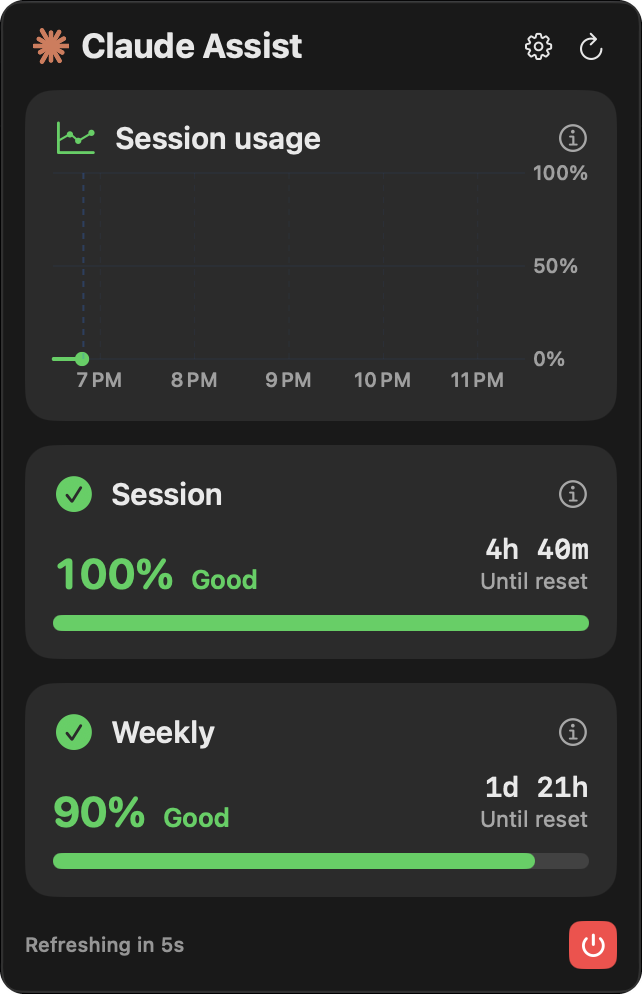

<div align="center">

# Claude Assist

**Your Claude usage limits, one glance away.**

A free macOS menu bar app that shows how much of your Claude session and weekly usage you have left, so you never hit a limit by surprise.



</div>

---

## About the app

Claude Assist lives in your Mac's menu bar. A small color-coded indicator shows your headroom at a glance, and one click opens a panel with the full picture:

| Feature | What it shows |
| --- | --- |
| **Session usage graph** | How your usage has moved across the current session window |
| **Session limit** | Percentage remaining in the current session, with a status label (e.g. *Good*) |
| **Weekly limit** | Percentage remaining for the week, with its own status label |
| **Reset countdowns** | Time left until each limit resets (e.g. `4h 40m`, `1d 21h`) |
| **Auto-refresh** | Updates automatically in the background; tap refresh for an instant update |
| **Menu bar only** | No Dock icon or windows. Quit any time from the power button in the panel |

Claude Assist is **completely free**: no subscriptions and no in-app purchases.

## Installation

1. Download Claude Assist from the website.
2. Open the download and drag **Claude Assist** into your **Applications** folder.
3. Launch it once. The icon appears in your menu bar; click it to see your usage.

## About this repository

This repository contains the landing page for Claude Assist: a single-page static website with no build step or dependencies.

- Modern design using Claude's brand colors (terracotta `#D97757` / `#C15F3C` on warm cream and charcoal)
- **Light and dark mode**: follows the system setting by default, with a toggle that remembers your choice
- Live, animated recreation of the app panel in the hero section
- Fully responsive, with reduced-motion support for accessibility

### Project structure

```
.
├── index.html          # Page markup
├── styles.css          # Styles, light/dark themes, animations, responsive layout
├── script.js           # Theme toggle, scroll reveals, live demo, download link
└── assets/
    ├── app-ui.webp     # App screenshot used on the page
    ├── app-ui.png      # Same screenshot (PNG, used in this README)
    └── screenshot.png  # Original full screenshot
```

### Run locally

Open `index.html` in a browser, or serve the folder:

```bash
npx serve .
```

### Configure the download link

All download buttons share a single link, set at the top of `script.js`:

```js
const DOWNLOAD_URL = "downloads/ClaudeAssist.dmg";
```

Replace it with the real download URL (for example, a `.dmg` on GitHub Releases).

### Deploy

The site is plain static files, so it can be hosted anywhere: Vercel, Netlify, GitHub Pages or Cloudflare Pages. On Vercel, import this repository with no framework preset and no build command.

---

## Disclaimer

Claude is a trademark of Anthropic, PBC. Claude Assist is an independent app and is not affiliated with or endorsed by Anthropic.
